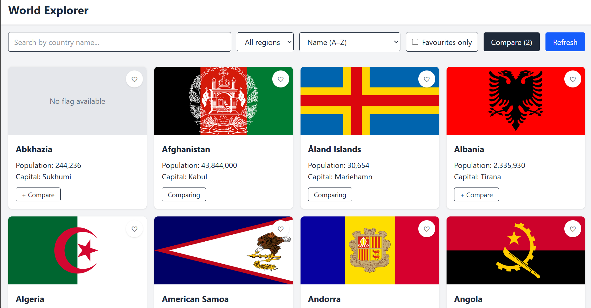
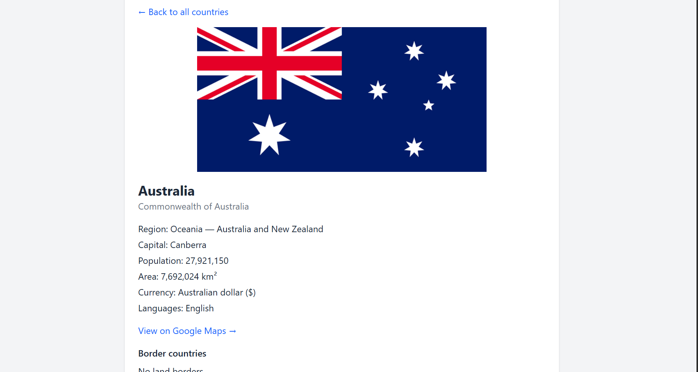
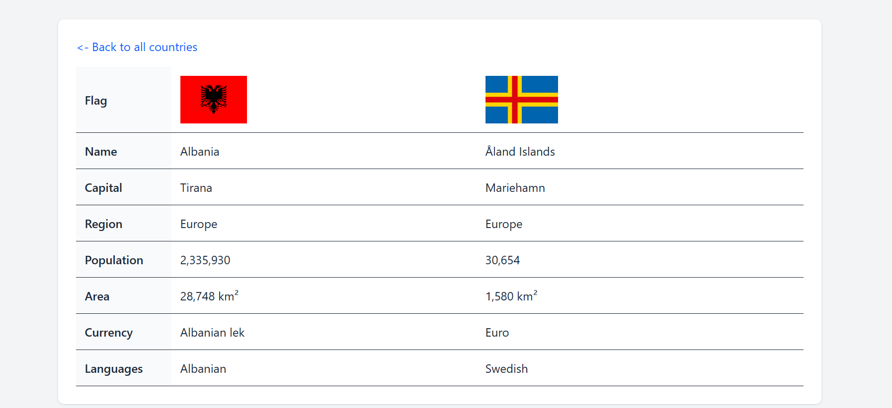

# World Explorer

World Explorer is a web app to browse every country in the world using live data from the REST Countries API. You can search, filter by region, sort, open a detail page for each country, save favourites and compare up to 3 countries side by side.

This is my Milestone 2 – JavaScript Mastery project for Cohort 10.

**Live site:** https://world-explorer-m2.vercel.app

## Screenshots

### Home

### Country detail

### Compare

## Features

- All country data comes live from the REST Countries API (no static data in the code)
- Search by country name (debounced, so it waits until you stop typing)
- Filter by region (the region list is built from the API data)
- Sort by name, population or area
- Detail page with capital, population, area, currency, languages and a Google Maps link
- Clickable border countries to jump from one country to its neighbours
- Favourites with a heart button, saved in localStorage so they stay after refresh
- "Favourites only" filter
- Compare up to 3 countries in a table
- Loading, error and empty states, with a Retry button
- Refresh button to fetch fresh data from the API
- Data cached in sessionStorage so reloading the page doesn't use API requests
- Responsive layout that works on mobile and desktop

## Tech used

- HTML
- Tailwind CSS v4 (CLI)
- Vanilla JavaScript (ES modules, fetch, async/await)
- REST Countries API v5
- Git and GitHub (feature branches and pull requests)
- Vercel for deployment

## Project structure